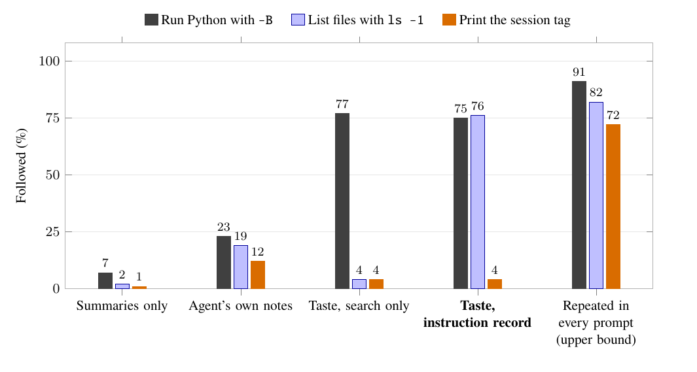

# Taste: A Git-Backed Memory for Long-Running Coding Agents

[](LICENSE)


A coding agent that works for hours cannot keep its whole history in context. Older history is replaced by a
summary, and the summary loses things the user said. Memory products such as Mem0 have a language model rewrite the
history into short notes instead, which costs model calls and can lose the same things.

Taste keeps what was said, word for word. It saves every message of a session unchanged in a git repository and finds
messages again by keyword search, with no model calls. A model also reads each user message once and copies any
standing instruction into a record that goes into every prompt.

This branch holds the code and the experiments behind our ICSE 2027 Student Research Competition submission of the
same title.

## Results



We ran 20 long coding sessions. In each, a coding model (Laguna S 2.1) worked through 30 or more tasks while its
history was summarized at least 90 times, and a scripted user gave three instructions. Two came with the first task, to run Python
with `-B` and to print a session tag before each submission. The third, to list files with `ls -1`, came later in a
message of its own.

- With summaries alone, the agent followed the three instructions in 7%, 2% and 1% of later commands. Notes the
  agent rewrote for itself at each summary reached only 23%, 19% and 12%.
- With Taste's instruction record, it followed the first two in 75% and 76%. The record caught the Python instruction
  in 17 of 20 sessions and the listing instruction in 19 of 20. Where it caught one, the agent came within about three
  points of the upper bound, in which the harness repeats every instruction in every prompt because it knows them in
  advance.
- Taste's search alone kept only the Python instruction. Each task's words matched the long first message that carried
  it, and rarely the short listing message.
- Taste kept the session tag only 4% of the time. The tag's value sat in a file the agent read, not in any user
  message, so the record never held it.

We also compared Taste's search with Mem0, giving both the same model and the same token budget.

- ConPACT is a set of 126 real coding sessions, each with one instruction from the user. Taste's search returned the
  instruction 70% of the time, and Mem0's notes held it 29% of the time.
- LongMemEval asks questions about long chat histories. On 450 of them, Mem0 is 18 points ahead when the agent may read
  2,000 tokens. At 8,000 tokens the gap is three points and not significant. With a weaker answering model, Llama 3.1
  70B, Mem0 leads at every budget. Mem0 made 248 model calls per chat history to write its notes.

## How it works

| Part | What it does | Code |
| --- | --- | --- |
| Storage | Appends each message unchanged and commits it on its own, in a plain git repository on the agent's machine | [`store.py`](taste/memstore/store.py) |
| Search | Ranks the stored messages by keyword match (BM25) with the current task and returns the best ones, up to a token budget | [`keyword.py`](taste/memstore/keyword.py), [`search.py`](taste/memstore/search.py) |
| Instruction record | Keeps each standing instruction, word for word, in a header at the top of the commit message that brought it | [`objects.py`](taste/memstore/objects.py) |

Storing and searching use no model calls. Filling the record takes one per user message. In the experiments, that
step and the step that repeats the record in every prompt live in the study code
([`session.py`](studies/long_run/session.py)), not yet in the package.

## Try the memory layer

You need Python 3.11 or newer and git.

```bash
git clone -b agent-os-paper https://github.com/zanwenfu/taste-is-all-you-need
cd taste-is-all-you-need
pip install -e .
```

```python
from pathlib import Path

from taste.memstore import CommitHeader, Store
from taste.memstore.objects import header_fields

store = Store.open(Path("memory"), "session-1")
chat = store.branch("conversation")

# Every message is kept unchanged, one commit each.
rule = "From now on, when you list a folder, use ls -1."
chat.turn(role="user", content=rule)
saved = chat.checkpoint("user message", header=CommitHeader(instructions=(rule,)))

chat.turn(role="user", content="The date parser in utils/dates.py fails on leap years. Please fix it.")
chat.checkpoint("user message")

# Find a message again by keyword.
for hit in store.search_contents("fix the date parser", kinds=("transcript",), limit=1):
    print(hit.snippet)

# Read a standing instruction back from its commit.
print(header_fields(store.state(saved.id).header)["instructions"])

store.close()
```

It prints the message the search found and the instruction read back from its commit.

```
content: The date parser in utils/dates.py fails on leap years. Please fix it.
['From now on, when you list a folder, use ls -1.']
```

The memory is an ordinary git repository, and `git -C memory log mem/session-1/conversation` lists one commit per
message.

## Reproduce the experiments

| Experiment | Code | What it needs |
| --- | --- | --- |
| Long coding sessions | [`studies/long_run/`](studies/long_run/). `make_session.py` builds a session from Terminal-Bench 2.1 tasks, `session.py` runs it, and `analyze.py` writes the tables. | Laguna S 2.1 served with vLLM (we used two 96 GB GPUs) |
| ConPACT | [`studies/memory_bench/swe.py`](studies/memory_bench/swe.py) | ConPACT's SWE-Natural set and Mem0 2.2.1 |
| LongMemEval | [`studies/memory_bench/run.py`](studies/memory_bench/run.py) retrieves, reads and judges, and `analyze.py` writes the tables. | LongMemEval-S, gpt-oss-120b served with vLLM, Mem0 2.2.1 and MemPalace 3.11.0 |

The opening comment of each module gives its exact commands. The Slurm scripts we ran are in each folder's `jobs/`.

## Earlier work in this repository

Taste began as an operating system for AI agents, in which a planner, workers and monitors record every step in one
git repository (release 0.2.0). Its description, demos and design notes are in [docs/agent-os.md](docs/agent-os.md),
and the idea behind it is in the essay
[Beyond the Harness: An Operating System for AI Agents](https://zanwenfu.com/blog/agent_harness_blog).

## Development

```bash
pip install -e '.[dev]'
pytest tests/test_memstore_*.py
```

No test needs an API key or a network.

## License

Copyright 2026 Zanwen Fu. The code is licensed under [Apache-2.0](LICENSE); keep the [NOTICE](NOTICE) with any copy you
redistribute. Two files under `taste/benchmarks/` are copied from SWE-bench under its MIT license, reproduced in
`LICENSES/`. GitHub's "Cite this repository" button gives a citation, from [CITATION.cff](CITATION.cff).

Questions, counter-examples and failure reports are welcome as
[issues](https://github.com/zanwenfu/taste-is-all-you-need/issues).
